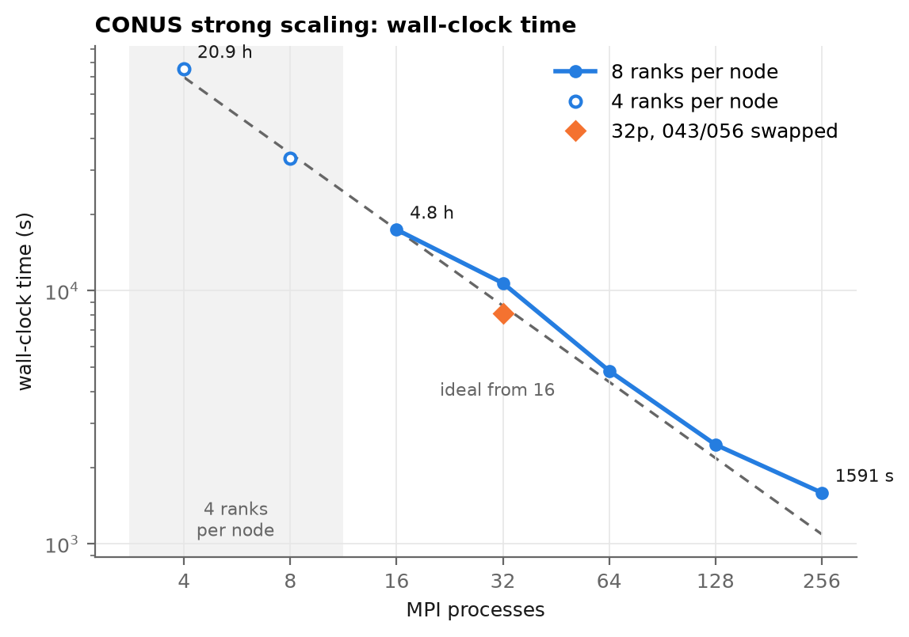
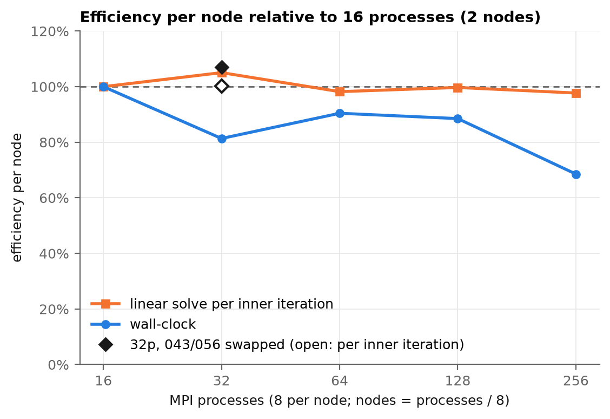
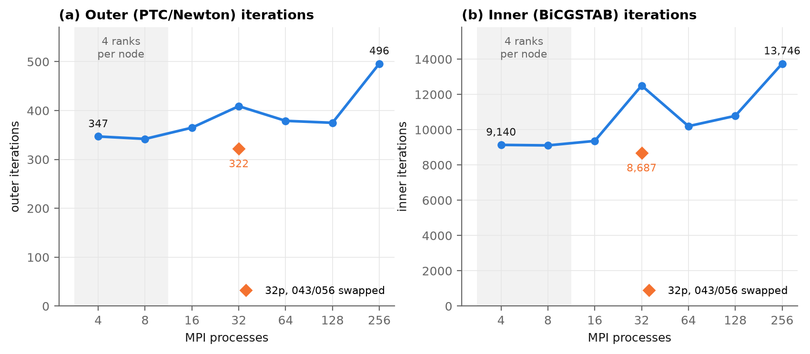
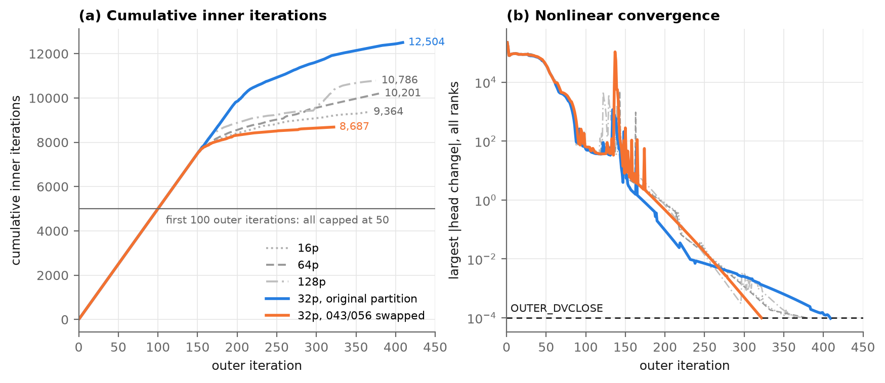
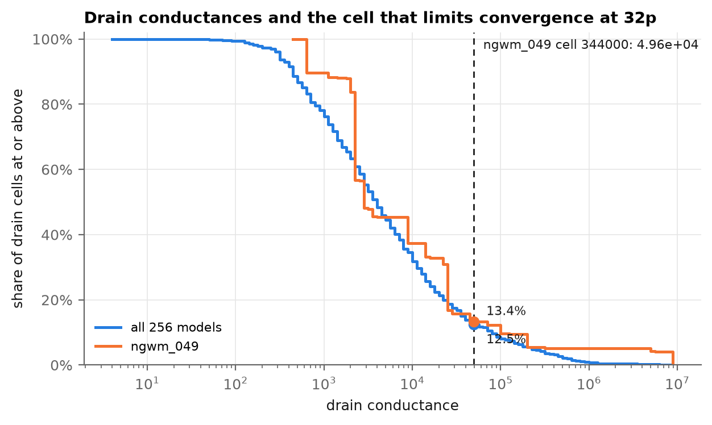
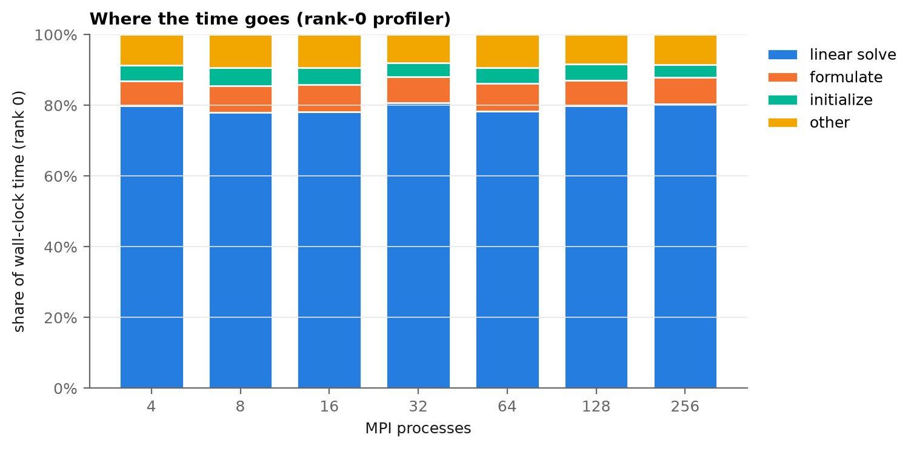
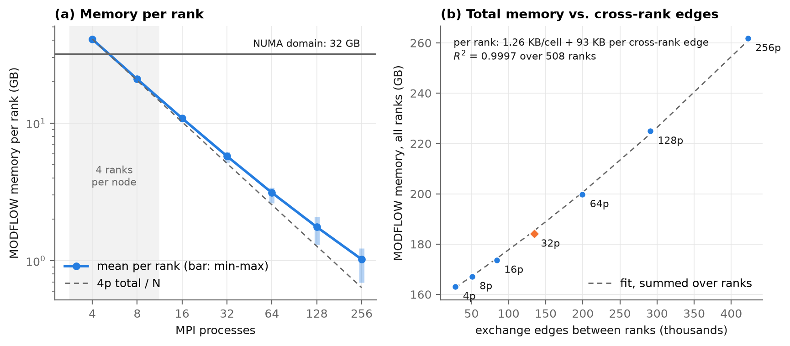

# Strong scaling of the CONUS model on Snellius

Findings from the `*_disv_ptcfix` sweep of the CONUS groundwater flow model with the
parallel (extended) build of MODFLOW 6 on the Snellius `rome` partition. The figures
are made by [plot_scaling.py](plot_scaling.py) from the CSV files in [data/](data/):

```
pixi run python doc/snellius-scaling/conus/plot_scaling.py
```

## Setup

**Model.** 256 GWF submodels (`ngwm_000`–`ngwm_255`), each a single-layer DISV grid of
about 488 k cells. That makes 124.9 M cells in total, all active (`IDOMAIN CONSTANT 1`).

- **Packages:** NPF, IC, DRN, GHB, RCH, and OC with NetCDF mesh output.
- **Formulation:** Newton with under-relaxation. One time step.
- **Exchanges:** 677 GWF-GWF exchanges with 422,276 connections in total, using
  `ANGLDEGX`, `CDIST` and `NEWTON`. A model has 939–4,234 exchange connections and 1–8
  neighbours.
- **No specific discharge** is computed, so the `calc_max_conns` defect found in
  saltfingers3D plays no role here: the budget step takes under 0.4 s in every run.

**Distribution.** Every process count runs the same 256 submodels; only the `HPC6`
partition file `ngwm_<N>p.hpc` changes. N divides 256 at every process count, so each
rank holds 256/N whole models and the same number of cells.

**Solver.** IMS with `COMPLEXITY complex`, which uses pseudo-transient continuation
(PTC).

- **Nonlinear:** `OUTER_DVCLOSE` 1e-4, up to 2,500 outer iterations.
- **Linear:** BiCGSTAB with at most 50 inner iterations per outer iteration,
  `INNER_DVCLOSE` 1e-5 and `INNER_RCLOSE` 1000.
- **In PETSc 3.22.0:** block Jacobi, with IMS ILUT as the sub-preconditioner (fill
  level 14, drop tolerance 1e-4), and PETSc's L2-norm convergence test
  (`-use_petsc_cnvg`).
- The `.petscrc` options for AMG were commented out for these runs.

**Build.** Module `MODFLOW/6.8.2rc-foss-2024a-d2368fb`, compiled Oct 29 2026 with GCC
13.3.0.

- Commit `d2368fb` is on the fork's `snellius` branch. Its Fortran source is identical
  to upstream `develop` at `3895c4735` (2026-10-28), which includes the PTC fix
  #3092. Only `meson.build` (the minimum Meson version) and `environment.yml` differ.
- The binary reports version `6.9.0.dev0`. The "6.8.2rc" in the module name is a label.

**Placement.** One batch of jobs, run on Oct 29–30 2026, exclusive nodes, with the
rankfiles from `run_examples_mr/hostfile`.

| N | nodes | ranks per node | rankfile |
|---|---|---|---|
| 4 | 1 | 4 | `hf_4_4` |
| 8 | 2 | 4 | `hf_8_4` |
| 16–256 | 2–32 | 8 | `hf_N_8` |

Only 16–256p have the same per-node layout, so **16p (2 nodes) is the baseline**, and
4p and 8p appear only in Figs. 1, 3, 4 and 5. Each N was run once.

**The 32p swap run.** A rerun of 32p on Nov 27 2026 (job 29746489), with the same build,
input and rankfile. Only the partition file differs: `ngwm_043` moves from rank 4 to
rank 19, and `ngwm_056` from rank 19 to rank 4. The two models have about the same size
(487,571 and 487,739 cells), so the balance is unchanged, and `ngwm_043` now shares a rank
with `ngwm_049`. Cross-rank exchange connections rise by 1% (133,214 → 134,532). The
input is in `~/prjs0960/conus_swap/` on Snellius. In the figures it's the orange (Fig. 2:
black) diamond.

**Timing source.** The "Run" total of the MODFLOW 6 profiler in the rank-0 listing file.
All 508 ranks terminated normally.

| N | nodes | run time | outer iterations | inner iterations | s per inner iteration | efficiency per node vs 16p | per inner iteration vs 16p |
|---|---|---|---|---|---|---|---|
| 4 | 1 | 20.9 h | 347 | 9,140 | 6.59 | – | – |
| 8 | 2 | 9.25 h | 342 | 9,111 | 2.85 | – | – |
| 16 | 2 | 4.85 h | 365 | 9,364 | 1.455 | 100% | 100% |
| 32 | 4 | 2.98 h | 409 | 12,504 | 0.692 | 81% | 105% |
| 64 | 8 | 4,823 s | 379 | 10,201 | 0.370 | 90% | 98% |
| 128 | 16 | 2,464 s | 375 | 10,786 | 0.182 | 89% | 100% |
| 256 | 32 | 1,591 s | 496 | 13,746 | 0.093 | 69% | 98% |
| **32, swapped** | 4 | 2.27 h | **322** | **8,687** | 0.726 | **107%** | 100% |

## Figures and the factors that explain them

### [Fig. 1](figures/fig1_wall_time.png): wall-clock time



- **Time falls from 20.9 h (4p, 1 node) to 4.85 h (16p, 2 nodes) to 26.5 min (256p, 32
  nodes).** From 16p to 256p that is an 11.0× speedup on 16× the nodes.
- **The curve isn't smooth.** 32p and 256p are slower than ideal, while 64p and 128p
  stay close to it. The iteration counts in Fig. 3 explain this; the hardware doesn't.
- **With one rank boundary moved, 32p runs at ideal speed or better** (diamond): 8,155 s
  against 10,723 s. Same nodes, same number of ranks, same cells per rank.

### [Fig. 2](figures/fig2_efficiency.png): efficiency per node relative to 16p



- **The linear solver scales almost ideally.** Measured as time per inner iteration,
  efficiency stays at 98–105% from 2 to 32 nodes.
  - No superlinear effect, unlike saltfingers3D. The model has a single layer, so there
    is no vertical-neighbour reuse distance that shrinks into cache as N grows (see
    saltfingers3D, Fig. 3).
- **Wall-clock efficiency (81%, 90%, 89%, 69%) almost exactly follows the change in
  inner iterations.** Efficiency per inner iteration × (inner iterations at 16p / inner
  iterations at N) gives 79%, 90%, 87% and 67%, against 81%, 90%, 89% and 69% measured.
  So nearly all the loss in efficiency comes from extra iterations. Communication and
  hardware account for very little.
- **The swap run confirms this directly:** at 32p the efficiency per inner iteration is
  100% (open diamond), and wall-clock efficiency goes from 81% to 107%. The only change
  is the iteration count.

### [Fig. 3](figures/fig3_iterations.png): outer and inner iterations



- **Inner iterations rise from 9.4 k (16p) to 13.7 k (256p), +47%, but not steadily:**
  32p needs 12.5 k while 64p needs 10.2 k.
  - Block Jacobi applies ILUT to each rank's own block. More ranks means more blocks and
    a weaker preconditioner.
  - How much weaker depends on *which* model boundaries become rank boundaries. That
    varies with the partition, which is why the curve isn't monotonic.
- **Outer iterations range from 342 to 496.** Each outer iteration is capped at 50
  inner iterations, so a weaker preconditioner also leaves each linear solve less
  converged, and the nonlinear (PTC/Newton) path then needs more steps. 256p has the
  most of both.
- **The swapped 32p partition needs 322 outer and 8,687 inner iterations**, fewer than
  any other run from 4p to 256p. So the count at a given N isn't a property of N alone:
  partitions with the same N and the same balance can differ by 44% in inner iterations.
- **These counts are much steadier than in the August sweep** (outer iterations
  307–1,008), presumably thanks to the PTC fix #3092 in this build.

### [Fig. 7](figures/fig7_swap_test.png): the 32p anomaly and the swap test



This is what happens in real applications: **where the rank boundaries fall matters as
much as how many there are.** One cell on one rank boundary cost the 32p run 44% more
inner iterations and 31% more wall time, and moving that boundary removed the cost.

The history of each outer iteration in the per-rank listing files shows where the extra
cost arises. Each rank's listing reports only its own models, so the location of the
largest head change in the whole domain needs all ranks' files combined.

- **The first 100 outer iterations are identical in cost at every N:** each hits the
  50-iteration cap, 5,000 inner iterations in total.
- **After that, 32p falls behind.**
  - In outer iterations 101–200 it needs 4,849 inner iterations, with 85 linear solves
    hitting the cap. 16p and 64p need 3,413 (53 capped) and 3,556 (50 capped).
  - In outer iterations 201–300 it needs 1,779, against 677 and 1,004.
- **The nonlinear progress itself is similar:** every run reaches residual 1e4 at outer
  iteration 191–213; 32p does so at 197.
- **Every run ends with a slow decay of the head change at one cell**, roughly halving
  every 25 outer iterations until it drops below `OUTER_DVCLOSE`. Which cell that is
  depends on the partition:
  - **16p:** an interior cell of `ngwm_079`.
  - **128p:** interior cells of `ngwm_086` and `ngwm_084`.
  - **32p:** **`ngwm_049` cell 344,000**, which dominates 177 of the final outer
    iterations. It lies on the 043–049 exchange boundary.
  - **64p:** ends on the other side of the same boundary (`ngwm_043` cell 307,565).
- The 043–049 boundary crosses ranks in every run, so whether it limits the run depends
  on how the rank blocks around it are composed.
- Cell 344,000 is a drain cell with conductance 4.96e4. That value isn't exceptional:
  12.5% of all drain cells, and 13.4% of those in `ngwm_049`, are at or above it (Fig. 6).
  The conductance alone doesn't explain the slow convergence there.
- **Mechanism:** a slowly converging nonlinear spot on a rank boundary. Block Jacobi
  drops the coupling across that boundary from the preconditioner, and the inner solves
  are capped at 50 iterations, so the correction across the boundary converges only
  through the outer iterations.
- **Test, confirmed (Fig. 7):** the 32p run with `ngwm_043` on the same rank as
  `ngwm_049`.
  - **(a)** All runs are practically identical up to outer iteration 150 (7,486–7,500
    inner iterations). By outer iteration 200 the original 32p has 9,849, which is
    1,000–1,500 more than the other runs (8,319–8,877). The swapped run has the fewest.
  - **(b)** The original 32p first reduces the head change faster than the others, but
    from outer iteration 230 (change about 1e-2) it enters the slow tail at cell
    344,000 and needs 180 more outer iterations. The swapped run decays at a steady
    rate down to `OUTER_DVCLOSE` and finishes at outer iteration 322.
  - Outer iterations: 409 → 322 (−21%). Inner iterations: 12,504 → 8,687 (−31%). Run
    time: 10,723 s → 8,155 s (−24%).
- **What this means:**
  - The other partitions also end on a slow cell, so the swap doesn't make 32p special;
    it shows how much one badly placed boundary can cost. The spread between 16p and
    256p in Fig. 3 is partly this kind of luck.
  - Partitioners that only balance load and minimize cut edges don't see it. It
    depends on the solution, so it can only be found after a run.
  - Not yet tested: whether a higher `INNER_MAXIMUM` or AMG makes the count independent
    of the partition.

### [Fig. 6](figures/fig6_drain_conductance.png): drain conductances



The share of drain cells with a conductance at or above a given value, for all 256
models and for `ngwm_049`. The histogram was computed on Snellius from all 122.5 M
drain entries (`data/drain_conductance_hist.csv`). The dashed line marks the cell that
limits convergence at 32p.

### [Fig. 4](figures/fig4_breakdown.png): where the time goes



- **The breakdown is almost the same at every N.**
  - Linear solve: 78–81%.
  - Formulate: 7–8%.
  - Initialize: 3.5–5%.
  - Other, mostly PTC calculations, MPI waits and output: 8–9.5%.
- So no part of the run stops scaling within 4–256p. That's unlike saltfingers3D at
  2048p, where initialization and Formulate took over.
- **Load balance is perfect.**
  - Every rank holds the same number of cells.
  - Per-rank linear-solve times differ by at most 0.4%.
  - The median MPI wait per rank is 4–24 s over a whole run.

### [Fig. 5](figures/fig5_memory.png): memory



- **(a) Memory per rank.**
  - At 4p, each rank uses 41 GB, more than one 32 GB NUMA domain. From 8p on it fits:
    21 GB at 8p and about 1 GB at 256p.
  - Above about 32p, memory per rank falls more slowly than 1/N.
- **(b) Total memory grows from 163 GB (4p) to 262 GB (256p).**
  - A fit over all 508 ranks gives 1.26 KB per cell + **93 KB per exchange connection
    that crosses ranks** + 0.1 GB per rank (R² = 0.9997).
  - Exchange connections between models on the same rank cost almost nothing.
  - saltfingers3D showed the same order of overhead (78 KB per edge). Both point at a
    per-connection cost in the parallel exchange or interface code that hasn't been
    traced yet.

### The 4 ranks-per-node points

- **4p → 8p** doubles both the ranks and the nodes (4 per node in both). The time per
  inner iteration falls 2.31× (116%).
  - Part of that is NUMA: 4p ranks need 41 GB, more than their 32 GB domain, so some of
    their memory is non-local.
- **8p → 16p** runs on the same 2 nodes with twice the ranks per node. The time per
  inner iteration falls 1.96× (98%), so memory bandwidth isn't saturated at 8 ranks per
  node with this placement.

## Caveats

- **One run per N**, so there's no estimate of run-to-run variation. For saltfingers3D
  that variation was ≤ 1.7% up to 512p.
- **These runs are from Oct 29–30.** The saltfingers3D reruns of Nov 27 showed slower
  Formulate and Initialize than in July, with an unchanged linear solve (see the
  saltfingers3D notes). Whether these October runs are affected is unknown.
- **The swap run is from Nov 27**, four weeks after the others. Its time per inner
  iteration is 5% higher than the original 32p (0.726 against 0.693 s), and Formulate
  per outer iteration is the same (1.9 s). The difference is in line with the
  multi-node slowdown seen in saltfingers3D, plus 1% more cross-rank connections, and
  doesn't affect the iteration counts.
- All times are from rank 0. Given the balance above, other ranks differ by well under
  1%.

## Open items

- Trace the memory overhead of about 93 KB per cross-rank exchange connection, which is
  shared with saltfingers3D.
- Optional: check whether the partition sensitivity also shows at other N, for
  example by moving the boundary that ends the 256p run.
- Optional: an AMG preconditioner run (`PCTYPE=amg` in `slurm.batch`), to see whether
  the growth in iterations disappears.
