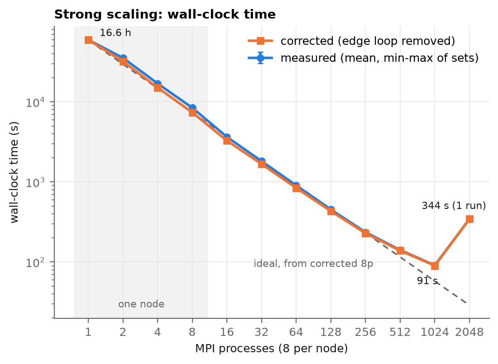
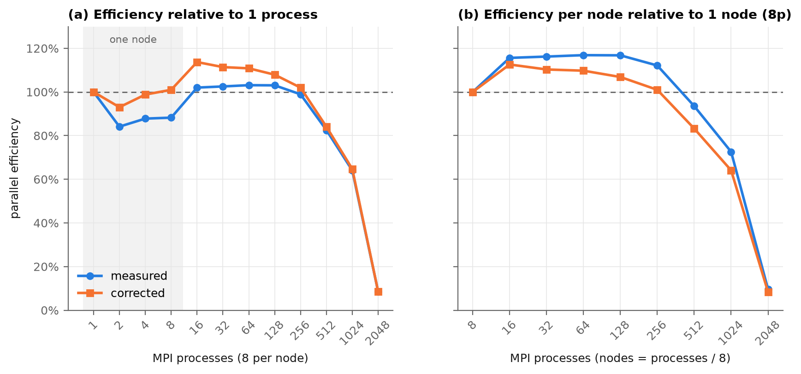
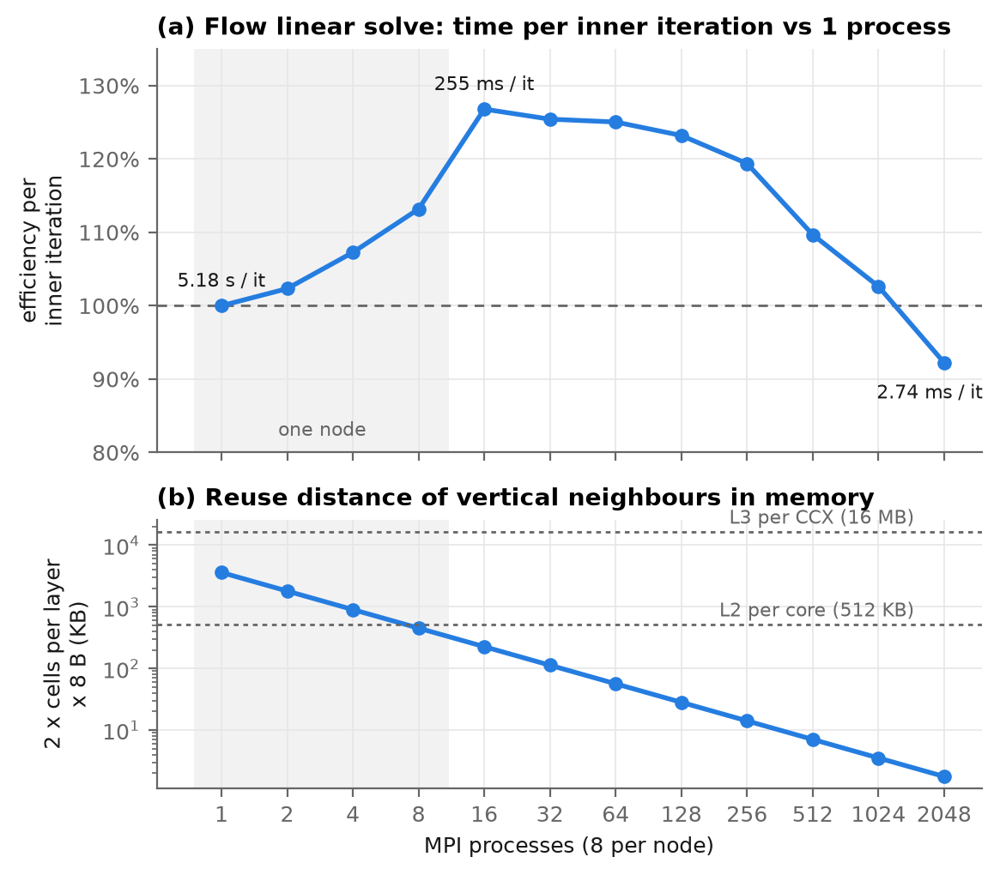
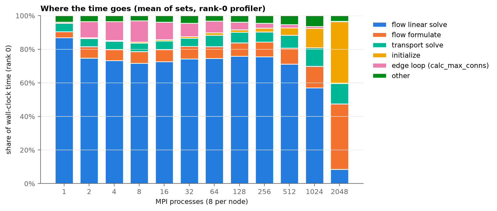
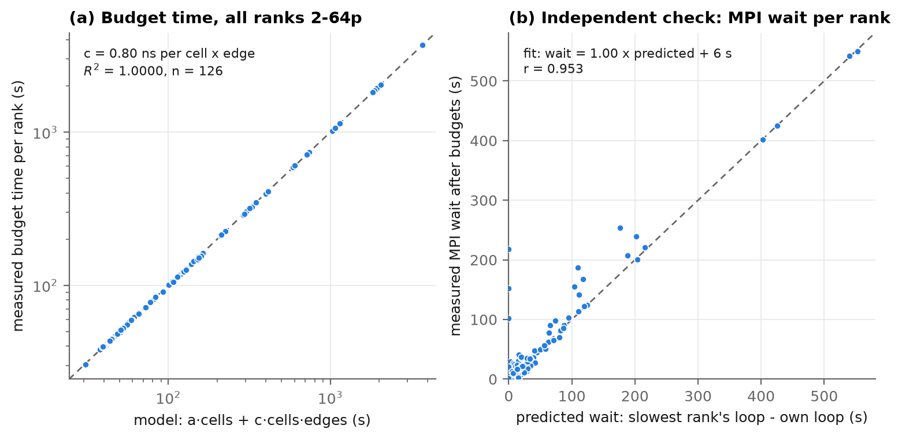
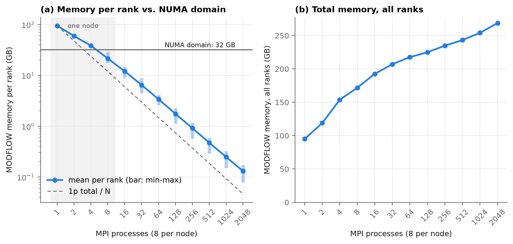

# Strong scaling of the saltfingers3D benchmark on Snellius

Findings from three sets of strong-scaling runs of the synthetic variable-density
benchmark (`cube3`) with the parallel (extended) build of MODFLOW 6 on the Snellius
`rome` partition. The figures are made by [plot_scaling.py](plot_scaling.py) from the
CSV files in [data/](data/):

```
pixi run python doc/snellius-scaling/saltfingers3d/plot_scaling.py
```

## Setup

**Model.** A DISV grid with 240 layers × 230,400 cells per layer (55.3 M cells), with a
coupled GWF and GWT model (BUY variable density). One stress period of 1200 s, 20 time
steps.

- **Solver:** IMS with BiCGSTAB, run as PETSc 3.22.0 with block Jacobi and an IMS ILU0
  sub-preconditioner. `DVCLOSE` is 1e-11 and `RCLOSE` is 1e-12.
- **Partitioning:** laterally only. Every partition keeps all 240 layers and gets
  230,400 / N cells per layer.

**Build.** MODFLOW 6.7.0 EXTENDED, commit `4f52a0c`, built with GCC 13.3.0 in the
`foss-2024a` toolchain (module `MODFLOW/6.7.0-foss-2024a-4f52a0c`).

**Machine.** Each `rome` node has 2 × AMD EPYC 7H12 with 64 cores each, set up as NPS4:

- 8 NUMA domains per node, each with 16 cores and 32 GB of memory;
- 512 KB of L2 per core and 16 MB of L3 per group of 4 cores (CCX);
- transparent huge pages set to `always`.

**Placement.** Jobs ran with `--exclusive`, 8 ranks per node, and a rankfile that pins
the ranks to cores 0, 16, …, 112.

- From 8p upward, every rank has a NUMA domain and an L3 to itself.
- At 2p the ranks sit on cores 0 and 64, one per socket.
- At 4p they sit on cores 0, 32, 64 and 96.

**Runs.**

| set | process counts | listing files kept |
|---|---|---|
| run_1 | 1–2048 | all ranks |
| run_2 | 1–1024 | rank 0 only |
| run_3 | 1–1024 | all ranks; the 1p run lives in `cube3/results_1` |

The 2048p case was run once. All runs terminated normally, and the inner iteration
counts are identical across the three sets.

**Timing source.** All times are the "Run" total of the MODFLOW 6 profiler in the rank-0
listing file.

- These are *not* Slurm job times. At high N, a job also includes staging thousands of
  files to and from `/scratch-shared`. For example, a 1024p job took 13–17 min against
  1.5 min inside MODFLOW.
- The listing's "Elapsed run time" is slightly longer than the profiler total, because it
  also covers startup.

## Correction for the `calc_max_conns` defect

`GwfNpfType%calc_max_conns` ([gwf-npf.f90](../../../src/Model/GroundWaterFlow/gwf-npf.f90))
sizes the work arrays for the specific discharge calculation. It loops over all exchange
edges for every cell, so its cost is O(cells × edges).

- It runs once, in the first call to `calc_spdis` in the first time step. The profiler
  books this under "Calculate budgets".
- It costs nothing at 1p, where there are no exchanges.
- At 2p it costs about 3400 s per rank.

We remove it from the measured times as follows:

1. Fit budget time per rank = a·cells + c·cells·edges over all 126 ranks of 2–64p in
   run_1. This gives c = 0.80 ns per cell×edge with R² = 0.99998
   ([fig5](figures/fig5_correction_validation.png)a).
2. The ranks synchronize right after the budget step, so the loop adds the *slowest*
   rank's cost to wall time. Corrected time = measured time − c·max(cells·edges) over all
   ranks. The loop count depends only on the partitioning, so one correction per N
   applies to all three sets.
3. Independent check: each other rank should then wait for the difference between the
   slowest rank's loop cost and its own. The measured MPI wait right after the budgets
   matches this prediction with slope 1.00 and r = 0.95
   ([fig5](figures/fig5_correction_validation.png)b). At 8p, rank 0 is predicted to wait
   554 s and measured 550 s.
   - The few points near zero predicted wait, with measured waits of 100–220 s, are the
     2p and 4p ranks. Their loop costs are almost equal, so the wait there comes from
     ordinary load imbalance.

The derived table is [data/derived_scaling.csv](data/derived_scaling.csv). The defect is
still present in `develop` and has the same pattern in `swf-dfw.f90`.

## Figures and the factors that explain them

### [Fig. 1](figures/fig1_wall_time.png): wall-clock time



- **Time falls from 16.6 h (1p) to 91 s (1024p)**, a 656× speedup on 128 nodes. 2048p
  takes 344 s, slower than 1024p.
- **Run-to-run variation is small.** The standard deviation across sets is ≤ 1.7% up to
  512p and 7.3% at 1024p. At 1024p, run_1 needed 83 s against 95 s for the other two
  sets; the difference is all in flow "Formulate" (7 s against 14 s).
- **Corrected and measured times differ by 7–13% for 2–64p.** The difference fades above
  128p, where the edge loop gets cheap: cells × edges per rank falls quickly as N grows.
- **The corrected curve runs below the ideal line between 16p and 256p.** That is
  superlinear speedup; Fig. 3 explains it.

### [Fig. 2](figures/fig2_efficiency.png): parallel efficiency



- **(a) Efficiency relative to 1p.** Measured, it is 84–88% within one node. Corrected,
  it is 93–101%.
  - The remaining 7% at 2p is algorithmic. The flow solution needs 40 outer iterations
    at 1p and 47–56 in every parallel run.
  - The total inner iterations change much less, from 10,020 to 10,300–10,900 (+3–9%).
  - The extra outer iterations mostly cost matrix assembly ("Formulate"), which happens
    once per outer iteration: 1.4 ks extra at 2p.
- **(b) Efficiency per node relative to 1 node (8p).** This is the baseline proposed for
  the paper.
  - The corrected 8p run is the reference. The measured 8p run includes 1068 s, 12.6%,
    of edge loop.
  - Corrected efficiency per node is 113% at 2 nodes and falls slowly to 101% at 32
    nodes. It then drops to 83% (64 nodes), 64% (128 nodes) and 8% (256 nodes).
  - The measured curve sits higher between 16p and 512p and lower at 2048p, because its
    8p base is inflated. This is why the correction matters most for the choice of
    baseline.
- **Why 1p is a weak baseline:**
  - The 1p rank needs about 95 GB, plus PETSc's matrix copies, in a 32 GB NUMA domain.
  - Superlinear scaling is, in Hoefler & Belli's words, "an indication of suboptimal
    resource use for small p".
  - Using the smallest representative configuration as the base follows the modified
    strong-scaling efficiency of Li & Ying: E = m·T_m / (P·T_P), with m the base process
    count.

### [Fig. 3](figures/fig3_per_iteration.png): flow linear solve per inner iteration



This measure takes out the iteration counts and the edge loop, so it shows the solver
kernel alone.

- **Superlinear from 2p, peaking at 127% at 16p.** The efficiency is 102% (2p), 107%
  (4p), 113% (8p) and 127% (16p). It then holds at 123–125% up to 128p.
- **Cache explanation.**
  - Cells are numbered layer by layer, so a cell's vertical neighbour is one layer of
    cells away in memory. Each solution value is used again about two layers later.
  - That reuse distance is 2 × cells per layer × 8 B. It shrinks from 3.6 MB at 1p to
    225 KB at 16p, crossing the 512 KB L2 between 8p and 16p, which is exactly where the
    efficiency jumps.
  - From 8p to 16p the time per iteration drops by 2.24×. Both cases have 8 ranks per
    node and one rank per NUMA domain, so only the size of each partition changed.
  - This explanation is consistent with all the data but hasn't been measured with
    hardware counters.
- **NUMA spill has no visible effect.**
  - At 1p, 2p and 4p each rank's memory is larger than its 32 GB NUMA domain; from 8p up
    it fits (Fig. 6).
  - Yet the speedup per doubling is the same at 2p→4p (2.10) and at 4p→8p (2.11), where
    the memory starts to fit locally.
  - Memory placed in a neighbouring domain on the same socket costs too little to show
    up here.
- **Gradual decline above 128p**, to 103% at 1024p and 92% at 2048p.
  - Each rank's share shrinks: 216 k cells at 256p and 27 k at 2048p.
  - Fixed costs per iteration therefore weigh more: halo exchange, the global
    reductions in BiCGSTAB, and imbalance.
  - At 2048p an inner iteration takes 2.7 ms. The linear solver itself still scales
    reasonably at 2048p; the collapse in Fig. 1 comes from elsewhere (Fig. 4).

### [Fig. 4](figures/fig4_breakdown.png): where the time goes



- **The flow linear solve dominates**: 87% at 1p and 71–76% from 2p to 512p.
- **The edge loop takes 9–13% at 2–16p**, shrinking to under 2% from 512p.
- **Transport is cheap.** Its solve takes 5–12% of run time and needs 40 outer
  iterations at every N.
- **"Other"** is mostly the regular budget and flow calculation, MPI waits outside the
  budget, and time-step bookkeeping.
- **2048p breaks down outside the solver.** Compared with 1024p (rank 0, single run):
  - initialization goes from 10 s to 127 s;
  - flow Formulate goes from 7 s to 134 s;
  - transport solve goes from 7–11 s to 42 s;
  - MPI wait goes from 5 s to 20 s;
  - while flow linear solve time *falls* from 52 s to 29 s.

  The cause has not been analysed yet. Setup and assembly cost that grows with the
  number of exchanges or ranks is the obvious candidate.

### [Fig. 5](figures/fig5_correction_validation.png): validation of the correction



See the correction section above.

### [Fig. 6](figures/fig6_memory.png): memory



- **(a) Memory per rank against the NUMA domain.**
  - Memory from the MODFLOW memory manager is 95 GB at 1p, 59 GB per rank at 2p and
    36–41 GB at 4p, all above the 32 GB domain.
  - At 8p it is 18–29 GB, which fits. PETSc's matrix and ILU copies come on top and are
    not counted here.
- **(b) Total memory grows from 95 GB (1p) to 269 GB (2048p).**
  - A fit over the 2–64p ranks gives about 1.9 KB per cell plus about 78 KB per exchange
    edge (R² = 0.987).
  - So ranks with the same cell count can differ by up to 1.65× in memory; at 8p, 17.8
    against 29.4 GB.
  - The per-edge overhead has not been traced in the code yet. Without it, a 4p rank
    would need about 27 GB plus PETSc's copies, which is close to the 32 GB domain.

## Open items

- Rerun 1–1024p once with the patched study build. The patch is commit `2f7b8c4f1` on
  branch `fix-calc-max-conns-4f52a0c`, which is `4f52a0c` plus only this fix.
  - On a 2-rank test model it gives byte-identical heads, concentrations and budget
    files, and identical iteration counts. The flow budget step drops from 2.2 s to
    0.5 s per rank.
  - Acceptance criteria for the rerun: iteration counts identical to the old runs, a
    rank-0 budget time of about 300 s at 2p, and run times within about 3% of
    `run_corrected_s` in `data/derived_scaling.csv`.
- Fix `calc_max_conns` in `develop` too, together with the same pattern in
  `swf-dfw.f90`, so the paper can cite a released version without the defect.
- Trace the memory overhead of about 78 KB per exchange edge.
- Analyse the initialization and Formulate cost at 2048p.
- Explain why the parallel runs need more flow outer iterations (47–56) than 1p (40).
- Optional: a short single-node run (2p, one time step, current against fixed code) to
  confirm the correction directly.
- Optional: hardware cache counters to confirm the L2 explanation in Fig. 3.

## References

- Hoefler, T., Belli, R. (2015). Scientific benchmarking of parallel computing systems:
  twelve ways to tell the masses when reporting performance results. SC15.
  [doi:10.1145/2807591.2807644](https://doi.org/10.1145/2807591.2807644).
  - Rule 1: report the base case of a speedup and its absolute performance.
  - §5.1: superlinear speedup indicates suboptimal resource use for small p.
  - §2.1.3: use the whole node. Our runs use 8 of 128 cores per node, which the paper
    needs to justify.
- Li, Y., Ying, L. (2017). Distributed-memory hierarchical interpolative factorization.
  [arXiv:1607.00346](https://arxiv.org/abs/1607.00346),
  [doi:10.1186/s40687-017-0100-6](https://doi.org/10.1186/s40687-017-0100-6) (journal
  not yet confirmed). Gives the modified strong-scaling efficiency relative to the
  smallest process count m.
- Verkaik, J., et al. (2024). GLOBGM v1.0: a parallel implementation of a 30 arcsec
  PCR-GLOBWB-MODFLOW global-scale groundwater model. GMD 17, 275–300.
  [doi:10.5194/gmd-17-275-2024](https://doi.org/10.5194/gmd-17-275-2024). Parallel
  MODFLOW 6 on Snellius; they chose the cores per node from a single-node memory
  bandwidth test.
